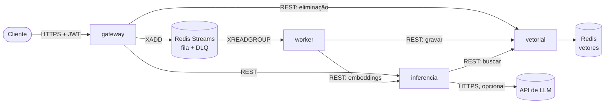

# Plataforma de IA como Serviço — C3.A2

**Sistemas Distribuídos e Computação em Nuvem · FAESA · 2026/2** · Prof. Howard Cruz Roatti

Plataforma em microsserviços que classifica sentimentos e responde perguntas sobre
documentos do próprio usuário (RAG). Conteinerizada, observável e protegida. A IA é
tratada como caixa-preta: o foco do projeto é a engenharia distribuída.

> **URL pública:** <https://plataforma-ia-gateway.onrender.com> · documentação interativa em [/docs](https://plataforma-ia-gateway.onrender.com/docs)
>
> O plano gratuito hiberna os serviços ociosos: a primeira requisição pode levar alguns minutos ou precisar ser repetida. As credenciais de avaliação não ficam no repositório.

---

## 1. Arquitetura



| Serviço | Responsabilidade | Porta (rede interna) |
|---|---|---|
| `gateway` | Única porta de entrada: JWT, rate limit, validação, roteamento e publicação na fila. Não tem lógica de IA. | 8000 (publicada) |
| `inferencia` | Sentimento, embeddings e RAG (busca + LLM). Sem estado, pode ter várias réplicas. | 8001 |
| `vetorial` | Armazenamento vetorial: gravação, busca por cosseno, isolamento por usuário e retenção. Único dono desses dados. | 8002 |
| `worker` | Consome a fila, pede embeddings e grava no vetorial. Pode ter várias réplicas. | 8003 (só healthcheck) |
| `redis` | Fila (Streams com consumer group), vetores e contadores de rate limit. | 6379 |
| `jaeger` | Coleta e visualização dos traces (ambiente local). | 16686 |

Os serviços se encontram pelo **nome** na rede do compose (descoberta de serviços).
Fila e vetores usam o mesmo processo Redis para caber no free tier, com prefixos de
chave separados; só o `vetorial` lê e escreve as chaves `vet:*`.

### Comunicação

- **Síncrona (REST):** `/predict` e `/perguntar`, em que o cliente espera a resposta.
- **Assíncrona (mensageria):** `/documentos` responde `202` com o id do lote; o worker
  indexa depois. A entrega é **ao menos uma vez**: o `XACK` só acontece depois de
  persistir. Como o id do documento é o hash do conteúdo, reprocessar não duplica.
  Mensagens de um worker que morreu são reassumidas (`XAUTOCLAIM`).
- **Entre serviços:** toda rota interna exige o cabeçalho `X-Token-Interno`.

---

## 2. Como executar do zero

Pré-requisito: Docker com Compose.

```bash
git clone https://github.com/tonyzinh/sd-2026-2-kit-c3a2.git
cd sd-2026-2-kit-c3a2
docker compose up --build
```

Não é preciso criar `.env`. Quando tudo estiver saudável:

- API e documentação interativa: <http://localhost:8000/docs>
- Traces (Jaeger): <http://localhost:16686>
- Login **local**: usuário `demo`, senha `demo-local`

Teste de ponta a ponta (apaga os dados do usuário de teste ao final):

```bash
python scripts/smoke.py
```

### Rotas

| Método | Rota | JWT | Descrição |
|---|---|:-:|---|
| GET | `/saude` | não | Saúde do gateway |
| POST | `/login` | não | Emite o token (`usuario`, `senha`) |
| POST | `/predict` | sim | Sentimento de um texto (`texto`) |
| POST | `/documentos` | sim | Enfileira até 20 textos (`textos`) → `202` + lote |
| GET | `/documentos/lotes/{lote}` | sim | Status do lote (só o dono vê) |
| POST | `/perguntar` | sim | RAG sobre os documentos do usuário (`pergunta`, `top_k`) |
| DELETE | `/meus-dados` | sim | Elimina os dados do usuário (LGPD) |
| GET | `/status` | sim | Disjuntores do gateway e métricas da fila |

```bash
TOKEN=$(curl -s -X POST localhost:8000/login -H "Content-Type: application/json" \
  -d '{"usuario":"demo","senha":"demo-local"}' | python -c "import sys,json;print(json.load(sys.stdin)['access_token'])")

curl -X POST localhost:8000/predict -H "Authorization: Bearer $TOKEN" \
  -H "Content-Type: application/json" -d '{"texto":"servico excelente"}'

curl -X POST localhost:8000/documentos -H "Authorization: Bearer $TOKEN" \
  -H "Content-Type: application/json" -d '{"textos":["O Raft elege um lider por maioria."]}'

curl -X POST localhost:8000/perguntar -H "Authorization: Bearer $TOKEN" \
  -H "Content-Type: application/json" -d '{"pergunta":"Como o Raft escolhe o lider?"}'
```

### Testes e desenvolvimento sem Docker

```bash
pip install -r requirements-dev.txt     # Python 3.12 ou superior
python -m pytest -q
python scripts/rodar_local.py --testar  # Redis falso + 4 processos + smoke test
```

O CI ([.github/workflows/ci.yml](.github/workflows/ci.yml)) roda os testes, sobe o
`docker compose`, executa o smoke test e confere no Jaeger que o trace passou por
`gateway`, `worker`, `inferencia` e `vetorial`.

---

## 3. Resiliência

O padrão aplicado nas chamadas entre serviços é
`disjuntor( retentativas( requisição com tempo-limite ) )`
([comum/cliente.py](comum/cliente.py)).

| Mecanismo | Como funciona | Local / nuvem |
|---|---|---|
| Tempo-limite | Em toda chamada HTTP e conexão Redis | HTTP 5 s / 30 s; Redis 3 s para conectar |
| Retentativa | Backoff exponencial com *full jitter*, só para timeout, erro de conexão, 429 e 5xx | 3 tentativas |
| Circuit breaker | Abre após 3 falhas (já esgotadas as retentativas), recusa na hora e depois deixa passar **uma** sonda. Um 4xx não conta. | reabre após 20 s |

Decisões:

- **Um disjuntor por rota de dependência.** O RAG fora do ar não bloqueia o `/predict`.
- **Sem retentativa no gateway para `/perguntar`.** A inferência já repete as chamadas
  dela; repetir nas duas camadas multiplicaria a carga (3 × 3) durante uma falha.
- **Degradação graciosa:** sem o LLM, `/perguntar` devolve os trechos recuperados com
  `"degradado": true`.
- **Worker:** circuito aberto adia o lote sem gastar tentativa; erro transitório
  reenfileira com espera crescente e, no limite (5 local, 8 na nuvem), vai para a
  **DLQ**; erro permanente vai direto para a DLQ.
- **Redis fora:** `/documentos` responde `503`; o rate limit passa a contar em memória
  e o `/predict` continua atendendo (com latência extra da tentativa de conexão).

### Como demonstrar

```bash
# 1) Circuito do gateway: derrube a inferência e chame /predict 4 vezes.
#    As primeiras dão 503 após as retentativas; depois, "circuito aberto" na hora.
docker compose stop inferencia
docker compose start inferencia

# 2) LLM fora: /perguntar passa a responder "degradado": true
#    (é preciso ter um documento indexado)
docker compose exec inferencia touch /tmp/llm_falha
docker compose exec inferencia rm /tmp/llm_falha

# 3) Fila absorvendo indisponibilidade: com o worker parado, /documentos ainda dá 202.
docker compose stop worker
docker compose start worker   # o lote pendente é processado

# Mais consumidores
docker compose up -d --scale worker=3
```

---

## 4. Observabilidade

Rastreamento distribuído com **OpenTelemetry** ([comum/telemetria.py](comum/telemetria.py)).
Em HTTP, o contexto W3C `traceparent` é propagado pela instrumentação. Na fila não há
cabeçalho: o gateway grava o `traceparent` **dentro da mensagem** e o worker o
restaura, de modo que o processamento assíncrono fica no mesmo trace:

```
gateway: POST /documentos
  gateway: fila publicar
    worker: worker processar lote
      worker: POST
        inferencia: POST /embeddings
      worker: PUT
        vetorial: PUT /itens
```

(Árvore resumida de uma execução local com `scripts/rodar_local.py`.)

- **Local:** abra o Jaeger, escolha o serviço `gateway` e a operação `POST /documentos`.
  Cada resposta do gateway também traz o cabeçalho `X-Trace-Id`.
- **Nuvem:** cada serviço imprime os spans em JSON no log (`OTEL_CONSOLE=1`); basta
  buscar o `trace_id` nos logs. Definindo `OTEL_EXPORTER_OTLP_ENDPOINT` e
  `OTEL_EXPORTER_OTLP_HEADERS`, os traces vão para um coletor OTLP externo.
- **Logs:** todas as linhas da aplicação carregam o `trace_id`.

---

## 5. Segurança

- **JWT (HS256)** no gateway, com validade de 60 minutos. `sub`, `exp` e `iss` são
  obrigatórios e o algoritmo é fixado (um token `alg=none` é recusado).
- **HTTPS:** no ambiente publicado, o TLS termina no proxy do Render, que também
  redireciona HTTP para HTTPS; o gateway envia `Strict-Transport-Security`.
  O ambiente local usa HTTP.
- **Rate limit:** 60 requisições por minuto por usuário; no login, 10 por IP e um teto
  global de 60, que vale mesmo se o IP for forjado.
- **Rede:** no compose, só o gateway é publicado (o Jaeger, apenas em `127.0.0.1`).
  Na nuvem os serviços internos têm URL pública, por limite do plano gratuito, e
  exigem o token interno em toda rota exceto `/saude`.
- **Segredos:** somente em variáveis de ambiente. Em produção os serviços **não sobem**
  com segredo ausente, curto ou de desenvolvimento, nem com senha menor que 12 caracteres.
- **Containers** rodam com usuário sem privilégios.

**Limitações conhecidas:** os usuários são fixos em variável de ambiente, sem cadastro
nem hash de senha; o token não pode ser revogado antes de expirar (remover o usuário
de `USUARIOS` bloqueia o acesso após o reinício); o token interno é um segredo único
compartilhado, e não mTLS; o rate limit de janela fixa permite rajada na virada do
minuto; o teto global de login permite que um atacante atrapalhe logins legítimos.

---

## 6. LGPD — dados tratados, finalidade e retenção

| Dado | Finalidade | Onde fica | Retenção |
|---|---|---|---|
| Usuário e senha | Autenticação | Variável de ambiente; a senha enviada no login não é gravada | Enquanto o usuário existir na configuração |
| Identificador do usuário no JWT (`sub`) | Autorização e isolamento dos dados | No token, em posse do cliente; no Redis, junto de documentos, mensagens e lotes | Token: 60 min; no Redis: como o dado associado |
| Documentos enviados e seus vetores | Responder perguntas do próprio usuário (RAG) | Redis (`vet:*`) | **24 h** após a última gravação (`RETENCAO_HORAS`) |
| Mensagens na fila (contêm o texto) | Indexação assíncrona | Redis Streams | Apagadas ao concluir; no máximo 24 h |
| Mensagens com falha (DLQ, contêm o texto) | Diagnóstico e reprocessamento | Redis Streams | No máximo 24 h |
| Status do lote | Consulta de andamento | Redis | 24 h |
| Texto do `/predict` e pergunta do `/perguntar` | Gerar a resposta | Somente em memória | Não são gravados |
| Endereço IP no login e usuário nas demais rotas | Rate limit | Redis, apenas como hash | 70 s |
| Registro de eliminação (usuário e horário) | Impedir que trabalho em andamento recrie dados apagados | Redis (`vet:apagado:*`) | 24 h |
| Logs e traces | Operação e depuração | Logs do provedor, Jaeger ou coletor OTLP | Conforme o provedor; Jaeger local em memória, até o container parar |

- **Base legal:** consentimento e execução do serviço solicitado, em contexto
  acadêmico e de demonstração. **Não envie dados pessoais reais ou sensíveis.**
- **Minimização:** a aplicação não registra em log nem em trace o texto, o nome de
  usuário, a senha, o token ou o IP. Os atributos de IP dos spans são sobrescritos, o
  log de acesso do uvicorn é desligado e as falhas guardam só o tipo do erro. A
  infraestrutura do provedor de nuvem mantém os próprios registros de acesso,
  segundo a política dele.
- **Compartilhamento:** por padrão o LLM é simulado e nada sai da plataforma. Se
  `LLM_API_KEY` for configurada, a pergunta e os trechos recuperados são enviados ao
  provedor do LLM (por padrão, OpenAI), possivelmente fora do Brasil.
- **Localização:** a região configurada para o deploy é `oregon` (EUA), o que implica
  transferência internacional.
- **Direitos do titular:** `DELETE /meus-dados` elimina documentos, vetores,
  mensagens pendentes ou com falha e status de lotes. Uma marca de eliminação impede
  que o worker recrie o que já estava em processamento. Logs e traces não são
  alterados, pois não contêm esses dados.
- **Persistência local:** o Redis do compose grava em volume (AOF). Registros apagados
  podem permanecer no arquivo até a próxima compactação; `docker compose down -v`
  remove tudo.

---

## 7. Relatório de trade-offs

### 7.1 CAP

O teorema CAP trata do que acontece **durante uma partição**. A plataforma não faz uma
escolha única: ela varia por caminho.

| Caminho | Durante partição ou queda do Redis | Escolha |
|---|---|---|
| `/predict` | Continua respondendo: JWT é verificado sem estado e o rate limit cai para memória | Favorece **disponibilidade**; o limite deixa de ser global |
| `/documentos` | Responde `503`; não aceita o que não consegue guardar | Favorece **consistência** |
| `/perguntar` sem o vetorial | `503`; não responde sem a base do usuário | Favorece **consistência** |
| `/perguntar` sem o LLM | Devolve só os trechos, marcados como degradados | Favorece **disponibilidade** |

- Com um único nó Redis não há réplicas divergentes: ele é um **ponto único de falha**
  e a troca é simplicidade contra disponibilidade.
- A indexação é **eventualmente consistente**: após o `202`, o documento só aparece nas
  buscas quando o worker termina. Por isso o cliente pode consultar o status do lote.
- A entrega ao menos uma vez evita perder trabalho ao custo de possíveis repetições,
  neutralizadas pela idempotência.
- **Durabilidade:** o AOF local (`everysec`, padrão do Redis) pode perder cerca de 1 s
  de escritas em uma queda. O Key Value gratuito do Render **não persiste**: um
  reinício apaga fila, vetores e lotes, mesmo os já confirmados com `202`. É
  aceitável em uma demonstração e inaceitável em produção.

### 7.2 Custo

| Item | Free tier (escolhido) | O que um plano pago compraria |
|---|---|---|
| 4 web services | US$ 0, com 750 horas de instância por mês para a conta toda | Sem hibernação, rede privada e background worker de verdade |
| Redis (Key Value) | US$ 0, 25 MB, 1 instância, sem persistência | Persistência e mais memória |
| LLM | US$ 0 no modo simulado | Cobrança por token do provedor |

- Planos pagos começam em torno de US$ 7 por mês **por serviço** (confira o preço
  vigente). Microsserviços multiplicam esse custo: quatro processos custam mais que um
  monólito. O ganho é escalar e implantar cada parte separadamente.
- As 750 horas bastam porque os serviços hibernam quando ociosos. Manter os quatro
  acordados com um *pinger* consumiria a cota em cerca de 8 dias (750 ÷ 4 = 187 h).
- **Vetorial próprio em vez de Qdrant ou pgvector:** não exige outra conta nem outro
  serviço pago. Em troca, a busca é exata e O(n) por usuário, e os vetores ocupam a
  mesma memória da fila. Para volumes grandes, trocaríamos por um índice ANN; só o
  serviço `vetorial` mudaria.
- **Embeddings por hashing:** sem modelo para baixar, sem estado e com dimensão fixa,
  mas capturam apenas sobreposição de palavras, não significado. A qualidade do modelo
  não é objetivo deste trabalho.

### 7.3 Latência

Medido em 26/11/2026, em um notebook Windows, **sem Docker**: Redis simulado em
Python, LLM simulado, requisições sequenciais. Serve para comparar os caminhos entre
si, não como desempenho de produção.

| Operação | Amostras | p50 | p95 |
|---|---:|---:|---:|
| `/predict` (síncrono, 1 salto interno) | 200 | 31,0 ms | 32,9 ms |
| `/documentos` (só enfileira) | 100 | 4,6 ms | 5,5 ms |
| `/perguntar` (2 saltos, busca em 100 documentos) | 100 | 62,2 ms | 67,2 ms |

A fila dos 100 lotes terminou de ser processada 4,8 s após o último envio.

- **Assíncrono:** o `202` responde bem mais rápido que as rotas síncronas porque adia o
  processamento. O preço é consultar o status e conviver com a consistência eventual.
- **Cada salto custa:** separar os serviços adiciona rede e serialização. Na nuvem
  gratuita isso pesa mais, pois as chamadas internas passam pela URL pública com TLS.
- **Cold start:** um serviço gratuito hiberna após 15 minutos sem tráfego e leva cerca
  de 1 minuto para voltar. A primeira requisição pode encadear mais de um despertar e
  levar minutos, ou falhar com `503`/`504` e funcionar ao repetir. Por isso os
  tempos-limite na nuvem são maiores (30 s, e 90 s no `/perguntar`). O trade-off é
  detectar falhas reais mais devagar.
- **Worker hibernado:** sem *background worker* gratuito, o gateway faz um `GET` no
  worker ao enfileirar e a cada consulta de um lote pendente.

---

## 8. Estrutura do repositório

```
├── comum/        # resiliência, fila, telemetria, logs, configuração
├── gateway/      # API Gateway: JWT e rate limit        (Dockerfile)
├── inferencia/   # sentimento, embeddings e RAG         (Dockerfile)
├── vetorial/     # armazenamento vetorial               (Dockerfile)
├── worker/       # consumidor da fila e DLQ             (Dockerfile)
├── tests/        # testes de unidade e de falhas
├── scripts/      # smoke test e execução sem Docker
├── deploy/       # passo a passo do deploy
├── docker-compose.yml
└── render.yaml   # blueprint do deploy
```

### Extensões opcionais

Há um **pipeline de CI** (testes + compose de ponta a ponta). A publicação a cada
commit pode ser feita pelo *auto deploy* do Render, ligado ao repositório. O número
de workers é ajustável manualmente (`--scale`); não há autoescalonamento.

### Créditos

Base: kit `sd-2026-2-kit-c3a2` do Prof. Howard Roatti. O modelo de sentimento vem do
kit C1.A2, e o circuit breaker, a retentativa, o cliente de LLM e o desenho da fila
foram adaptados do nosso C2.A2. Houve apoio de ferramenta de IA na programação,
conforme permitido pelo enunciado.
